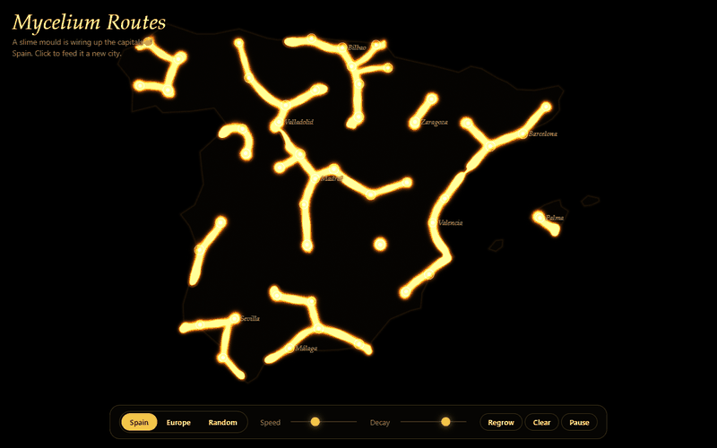
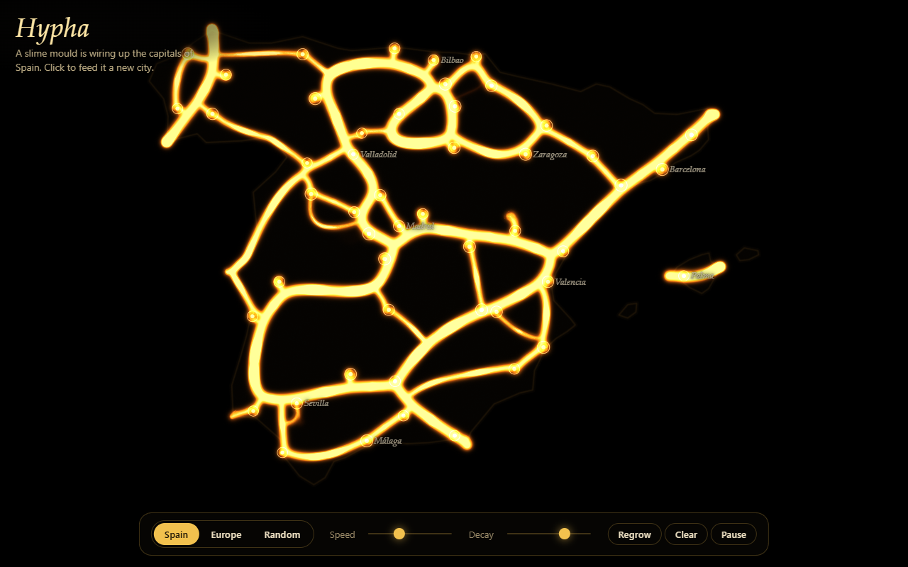

# Hypha

A slime mould wires up the capitals of Spain. Hundreds of thousands of agents crawl across a GPU trail map, leave a scent behind and follow each other's scent, and within seconds golden filaments appear between the cities and settle into an organic road network. Click to add a city and watch the network reorganise.



**Live demo: https://jortegadmr.github.io/hypha/**

## Features

- Physarum agent simulation running entirely on the GPU (WebGL2, no libraries), up to 262,144 agents.
- Starts by itself with the Spain preset: 48 mainland provincial capitals plus Palma, an embedded simplified coastline and no network requests.
- Presets for Spain, Europe (36 capitals) and Random.
- Click or tap empty land to add a city, click a city to remove it. New cities bloom with a burst of agents. In the Spain preset the sea is off limits.
- Speed and decay sliders, regrow, clear and pause (space bar).
- Pulses travel along the filaments, so the highways visibly beat.
- Adaptive quality: the agent count drops automatically on slow GPUs.
- Responsive layout, touch input, `prefers-reduced-motion` support and a readable message when WebGL2 is not available.



## How it works

Every frame runs a few steps of the same three passes on float textures, ping-ponged between frames:

1. **Agents**: each agent samples the trail map ahead of it at three sensors (left, front, right), steers towards the strongest signal and moves forward. A small attraction field around each city, computed on the GPU, pulls agents in. Agents that touch the sea turn around. Now and then an agent respawns at a random city, which is what keeps new roads growing outwards.
2. **Deposit**: all agents are drawn as points with additive blending into the trail map.
3. **Diffuse and decay**: the trail is blurred and faded. A second channel keeps a slow memory of the trail, so busy routes stay bright while unused ones wither.

The display pass turns the trail into a gold ramp, adds a soft glow, and modulates brightness with a wave based on the distance to the nearest city.

## Stack

TypeScript, WebGL2 (GLSL ES 3.00), Vite. No runtime dependencies. Needs WebGL2 and the `EXT_color_buffer_float` extension.

## Run locally

```bash
npm ci
npm run dev      # http://localhost:5173
npm run build    # type-check and production build into dist/
npm run preview
```

## Known limitations

- The Canary Islands, Ceuta and Melilla are not included.
- The coastline is hand-simplified and meant for looks, not for geography.
- Resizing the window regrows the network.

## License

MIT, see [LICENSE](LICENSE).
